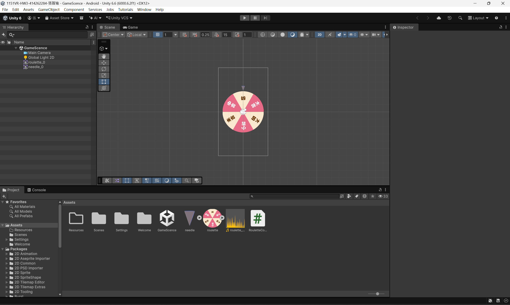

# 1151VR-HW3-414262284-張智瑜

## 專案截圖

## GitHub 連結

https://github.com/cychang1688-sketch/1151VR-HW3-414262284-CCY.git

## YouTube 連結

https://youtube.com/shorts/yKaAb8zQwAM

## 製作流程及相關操作說明

本次作業使用 Unity 建立 2D 輪盤遊戲，首先匯入輪盤及指針圖片，並調整物件的位置與大小。接著建立 RouletteController C# 腳本，將程式掛載至輪盤物件，透過程式控制輪盤旋轉，並利用速度遞減的方式讓輪盤逐漸減速停止。另外加入 Audio Source 元件及旋轉音效，讓輪盤轉動時能播放聲音，並調整 Main Camera 的顯示範圍，避免輪盤超出手機螢幕。完成後將專案建置成 Android APK，並安裝至手機進行測試。操作方式為使用滑鼠左鍵或手指點擊螢幕，輪盤便會開始旋轉並逐漸減速，停止後由指針指出結果，再次點擊即可重新旋轉。
